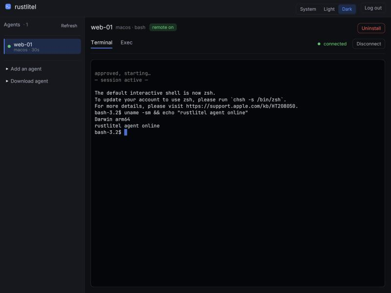
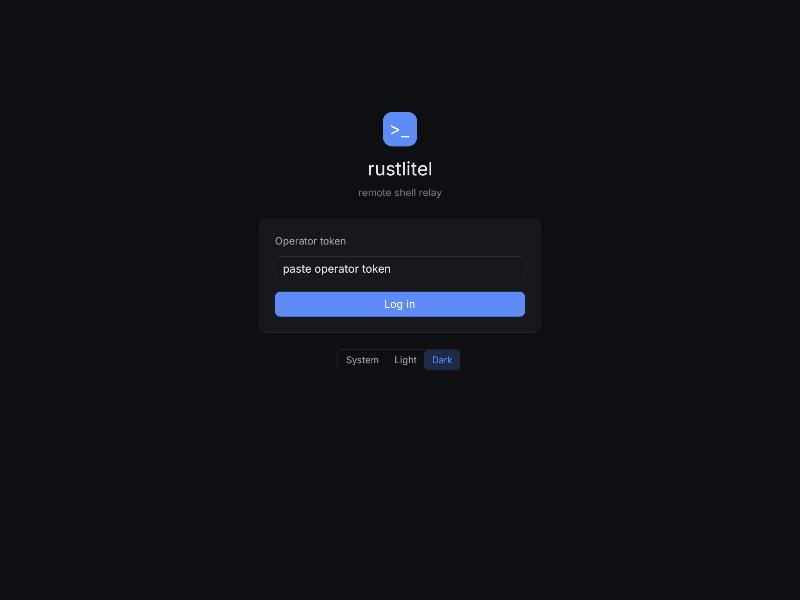

# rustlitel

Reach a machine that has **no public IP** (behind NAT/CGNAT) — Windows, macOS or
Linux — from a web browser, the `rustlitel` CLI, or a script / your own Claude
session, without port-forwarding.

The target runs a small **agent** that *dials out* to a **relay** you host. The
browser (or an HTTP client) talks to the relay; the relay bridges the two.
Nothing listens for inbound connections on the target side.

```
   browser (egui/WASM) ─wss─►┌───────────────┐◄─wss─ agent (behind NAT)
   POST /api/exec ──────────►│     relay     │       PTY (ConPTY / openpty)
   rustlitel CLI / Bearer ──►│ auth + bridge │       child proc → exec
                             └───────────────┘       dials OUT only
```

Ways to use it:

* **Interactive terminal** in the browser (egui/WASM) — for a human.
* **`rustlitel` CLI** — `login` (Keycloak device flow), `agents`, `exec`, and on
  Windows agents `sessions`, `windows`, `screenshot`, `window`. Download it from
  the relay itself at `/cli`.
* **`POST /api/desktop`** — screenshots (screen, monitor or window, any logged-on
  session) and window management (list, focus, minimize, maximize, restore,
  move/resize, close).
* **`POST /api/exec`** — one command in, `stdout`/`stderr`/exit code out. The
  primitive a script or an LLM session uses to inspect and fix the machine.



---

## Security & consent model

Access is gated at several layers; an agent is harmless until someone explicitly
opts in.

| Layer | Control |
|---|---|
| **Operator → relay** | Operator token. Browser exchanges it for a session cookie; scripts send `Authorization: Bearer <token>`. |
| **Agent → relay** | Enrollment token (`RUSTLITEL_AGENT_TOKEN`). An agent with the wrong token never registers. |
| **Session link** | Each interactive session is authorised by a single-use nonce tied to the exact open request — the agent token is never put in a URL. |
| **Transport** | TLS terminated at the ingress (`wss://…`). The relay itself speaks plain HTTP behind it. |
| **Agent opt-in** | Without `--allow-remote` the agent connects and is *listed* but declines every session/exec. Running it is harmless until you opt in. |
| **Install consent (Windows)** | `rustlitel-agent install` shows a dialog spelling out *unattended* access and only proceeds on **Yes**. |
| **Per-session confirm** | `--confirm` (foreground only) additionally pops a y/N in the agent console for every interactive session. |

The relay also checks the browser `Origin` on WebSocket upgrades / login when
`RUSTLITEL_PUBLIC_ORIGIN` is set, and compares all tokens in constant time.

---

## Components

* `crates/relay` — `rustlitel-relay`: axum HTTP/WS server. Serves the web UI, the
  operator terminal WS, the agent control/session WS, and `/api/*`. Holds no
  state beyond in-memory maps (connected agents, open terminals; sessions and
  installer links are signed tokens); one replica.
* `crates/agent` — `rustlitel-agent`: dials the relay, runs PTYs (`portable-pty` →
  ConPTY on Windows) and non-interactive `exec`. On Windows it can install
  itself as an auto-start service.
* `crates/proto` — shared wire types.

---

## Build

```bash
make build          # relay + agent for this host (release)
make test
```

Requires a recent stable Rust. The relay has no C deps; the agent uses
`portable-pty` (+ `windows-service`/`windows-sys` on Windows).

### Windows agent binary

Release `.exe`es are produced by CI (`.github/workflows/build.yml`, MSVC
`windows-latest`) and uploaded as the `rustlitel-agent-windows-x64` artifact. To
cross-build from Unix: `rustup target add x86_64-pc-windows-gnu`, install the
mingw-w64 linker, then `make agent-windows`.

### macOS binaries

`make agent-macos cli-macos` builds universal (arm64 + x86_64) binaries into
`dist/`, from where the image serves them (the CLI from `dist/cli/`). On macOS the agent runs in the
foreground and asks for consent on the console; there is no launchd `install`.

---

## Run the relay (locally)

```bash
make gen-tokens      # prints two fresh tokens
RUSTLITEL_OPERATOR_TOKEN=... \
RUSTLITEL_AGENT_TOKEN=...   \
RUSTLITEL_COOKIE_SECURE=0   \
RUSTLITEL_LISTEN_ADDR=127.0.0.1:8099 \
  make run-relay
```

Open <http://127.0.0.1:8099>, sign in with the operator token.
(`RUSTLITEL_COOKIE_SECURE=0` is only for plain-HTTP localhost; behind TLS leave it on.)

### Relay configuration (env)

| Var | Default | Meaning |
|---|---|---|
| `RUSTLITEL_LISTEN_ADDR` | `0.0.0.0:8080` | bind address |
| `RUSTLITEL_OPERATOR_TOKEN` | *(required)* | operator login / Bearer token |
| `RUSTLITEL_AGENT_TOKEN` | *(required)* | agent enrollment token (must differ) |
| `RUSTLITEL_PUBLIC_ORIGIN` | *(unset)* | e.g. `https://relay.example.com`; enables Origin checks. A comma-separated list (`https://a.example,https://b.example`) serves one relay under several names: each request uses the listed origin its `Host` names (else the first) for the OIDC redirect, logout, installer links and the relay URL baked into installers, and any listed origin passes the Origin check |
| `RUSTLITEL_SESSION_TTL_HOURS` | `720` | operator session lifetime (signed cookie, survives a relay restart; rotate the operator token to end all sessions) |
| `RUSTLITEL_SHORT_LINK_TTL_DAYS` | `30` | installer link lifetime (signed, survives a relay restart; refuse one by adding the SHA-256 of its code to `RUSTLITEL_REVOKED_KEYS`) |
| `RUSTLITEL_COOKIE_SECURE` | `1` | set `0` only for local HTTP |
| `RUSTLITEL_OPEN_TIMEOUT_SECS` | `30` | how long to wait for an agent to accept a session |
| `RUSTLITEL_EXEC_DEFAULT_TIMEOUT_SECS` | `120` | default exec timeout |
| `RUSTLITEL_EXEC_OUTPUT_CAP` | `1048576` | per-stream output cap (bytes) |
| `RUSTLITEL_DESKTOP_OUTPUT_CAP` | `33554432` | cap on one desktop answer (a base64 screenshot) |
| `RUSTLITEL_AGENTS_DIR` | `/srv/agents` | dir of stock agent binaries (downloads / installer baking) |

**Operator SSO via Keycloak (optional).** Set all four to turn the browser login
into in-app OIDC (the relay is the OIDC client, verifies the ID token, shows the
username); unset, it falls back to operator-token login. `/api/exec` keeps using
the Bearer operator token regardless.

| Var | Meaning |
|---|---|
| `RUSTLITEL_OIDC_ISSUER` | e.g. `https://keycloak.example/realms/main` |
| `RUSTLITEL_OIDC_CLIENT_ID` | confidential client id |
| `RUSTLITEL_OIDC_CLIENT_SECRET` | client secret |
| `RUSTLITEL_OIDC_REDIRECT_URL` | `https://<host>/oauth2/callback`; with several public origins only its path counts: the login uses `<request's origin><path>`, so register that callback for every origin in the IdP |
| `RUSTLITEL_OIDC_ALLOWED_GROUP` | required group/role claim value (optional) |
| `RUSTLITEL_OIDC_USERNAME_CLAIM` | default `preferred_username` |
| `RUSTLITEL_OIDC_GROUPS_CLAIM` | default `groups` (also checks `realm_access.roles`) |

---

## Install the agent on Windows (unattended)

From an **elevated** (Administrator) PowerShell:

```powershell
rustlitel-agent.exe install --relay wss://relay.example.com --token <AGENT_TOKEN>
```

This shows a consent dialog describing unattended access. On **Yes** it:

* registers a Windows service **`rustlitel-agent`** set to **auto-start at boot**
  (runs even with no one signed in), with `--allow-remote` baked in;
* starts it immediately.

Remove it later:

```powershell
rustlitel-agent.exe uninstall
```

Service logs go to `%ProgramData%\rustlitel-agent\agent.log`.

### Run in the foreground (dev / Unix)

```bash
rustlitel-agent --relay ws://127.0.0.1:8099 --token <AGENT_TOKEN> --allow-remote
# add --confirm to approve each interactive session with a console y/N
```

### Agent flags

`--relay` `--token` (also `RUSTLITEL_RELAY` / `RUSTLITEL_AGENT_TOKEN`), `--name`, `--id`,
`--shell` (repeatable; first is default), `--allow-remote`, `--confirm`,
`--reconnect-secs`.

---

## Use it

### Browser

Sign in → pick an agent (green dot = remote enabled) → choose a shell → a session
opens once the agent accepts it.



### Exec API (scripts / your own session)

```bash
RELAY=https://relay.example.com
OP=<operator token>

# list connected machines
curl -s $RELAY/api/agents -H "Authorization: Bearer $OP" | jq

# run one command
curl -s $RELAY/api/exec -H "Authorization: Bearer $OP" \
  -H 'Content-Type: application/json' \
  -d '{"agent":"win-box","command":"Get-Service Spooler | Restart-Service; Get-Service Spooler","timeout_secs":60}'
# -> {"exit_code":0,"stdout":"...","stderr":"","truncated":false,"error":null}
```

`shell` is optional (`powershell` | `cmd` | `pwsh` on Windows; `bash` | `sh` |
`zsh` on Unix). This is enough for an operator's Claude session to loop:
run a diagnostic, read the structured result, decide, run a fix, verify.

### Desktop API (Windows agents)

The installed agent is a service in session 0, which has no screen. For a
desktop request it starts a copy of itself (`desktop-helper`, still
LocalSystem) inside a user's session, so it sees what that user sees and can act
on elevated windows too. By default that is the console session when someone is
logged on there, else the active RDP session; `"session": <id>` picks any
session with a user (`"action":"sessions"` lists them). Windows does not draw a
disconnected session; its screenshot is assembled from its windows' own
rendering (`"composed": true` and a `warning` in the answer).

```bash
curl -s $RELAY/api/desktop -H "Authorization: Bearer $OP" -H 'Content-Type: application/json' \
  -d '{"agent":"win-box","action":"list_windows"}'
curl -s $RELAY/api/desktop -H "Authorization: Bearer $OP" -H 'Content-Type: application/json' \
  -d '{"agent":"win-box","action":"screenshot","format":"jpeg","max_width":1600}' | jq -r .data | base64 -d > s.jpg
curl -s $RELAY/api/desktop -H "Authorization: Bearer $OP" -H 'Content-Type: application/json' \
  -d '{"agent":"win-box","action":"window","op":"move","target":{"title":"Notepad"},"x":0,"y":0,"width":800,"height":600}'
```

Actions: `sessions`; `list_windows` (`all`); `screenshot` (`window` target,
`monitor`, `format` png|jpeg, `quality`, `max_width`); `window` with `op`
focus|minimize|maximize|restore|move|close and a `target` of `hwnd`, `title`,
`process` and/or `pid` (substrings, must match one window). Every answer is
`{"ok":true,…}` or `{"ok":false,"error":…}`. Agents built before this report
501 until they self-update.

### CLI downloads

`GET /cli` is a public page with the CLI for macOS (universal), Linux (static
x86-64) and Windows, and `GET /cli/<file>` the binaries. Public on purpose: the
CLI holds no key, token or address, and does nothing without a Keycloak login
that has the operator role. Agent installers stay behind auth (they carry join keys).

---

## Deploy

See [deploy/README.md](deploy/README.md) — build + push the image to your
registry and run the relay behind a TLS ingress (WebSocket-friendly timeouts),
with the operator/agent tokens injected from your secret store.
